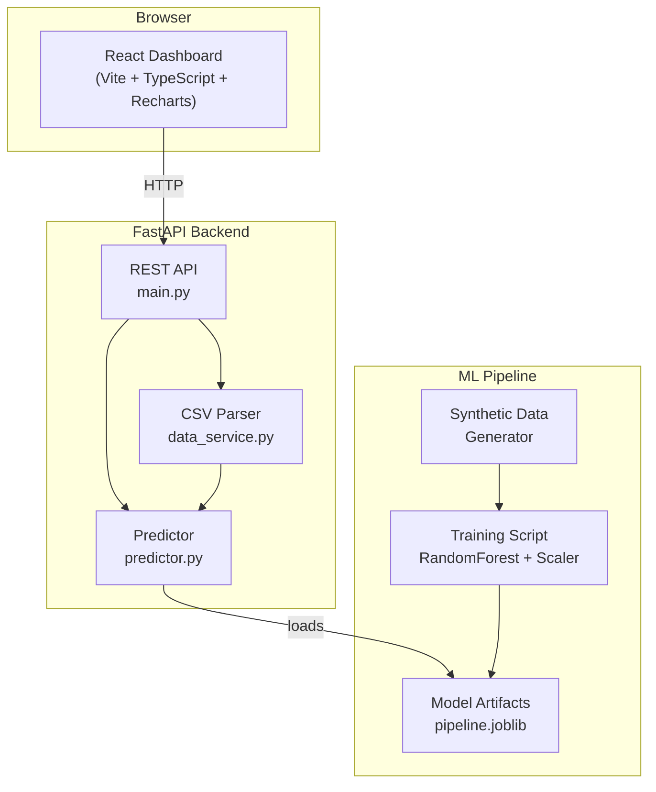

# 🛡️ CyberSentinel

**ML-Based Network Intrusion Detection Dashboard**

An educational machine-learning project that classifies network flow records as **benign** or **suspicious** using a Random Forest classifier, served through a FastAPI backend and visualized in a React dashboard.

> **⚠ Important Disclaimer:** This is a dataset-based educational prototype, **NOT** a production intrusion detection system. It analyzes supplied CSV flow records — it does **NOT** capture or monitor live network traffic. Synthetic-demo performance does not establish real-world IDS effectiveness. Do not rely on this system for actual security decisions.

---

## 📌 Resume Summary

> **CyberSentinel** — Built a full-stack ML-powered network intrusion detection dashboard. Implemented a Random Forest classifier on network flow features with a scikit-learn pipeline (preprocessing + inference), a FastAPI REST API with CSV upload analysis, and a React/TypeScript dashboard with interactive charts (Recharts). Achieved [see eval report] test-set metrics on CIC-IDS2017-schema data. Includes 37 automated tests, deterministic synthetic data generation, and deployment-ready configuration.

---

## 🏗 Architecture



See [docs/architecture.md](docs/architecture.md) for detailed data-flow diagrams.

---

## 🔧 Technology Stack

| Layer | Technology |
|-------|-----------|
| ML / Data | Python 3.11+, scikit-learn, pandas, NumPy, joblib |
| Backend | FastAPI, Uvicorn, Pydantic v2 |
| Frontend | React 19, TypeScript, Vite, Recharts |
| Testing | pytest, FastAPI TestClient |
| Deployment | Render (backend), Vercel (frontend) |

---

## ✨ Features

- **Dual-mode operation**: Works with synthetic demo data out of the box, or with the real CIC-IDS2017 dataset
- **Random Forest classifier** with StandardScaler preprocessing pipeline
- **Stratified train/test split** (80/20) with class-weight balancing
- **FastAPI REST API** with CSV upload, batch prediction, validation, and health checks
- **React dashboard** with:
  - API connectivity & model status indicators
  - Summary cards (total, benign, suspicious, %)
  - Pie chart for classification distribution
  - Per-class precision/recall/F1 bar chart
  - Confusion matrix visualization
  - Feature importance ranking
  - CSV upload with drag-and-drop & progress bar
  - Paginated, filterable, searchable results table
  - Model info panel with limitations disclaimer
- **37 automated backend tests** covering all endpoints, validation, and consistency
- **Deployment-ready** with Render and Vercel configuration

---

## 🚀 Quick Start (macOS)

### Prerequisites

- Python 3.11 or newer
- Node.js 18+ and npm
- macOS (tested on MacBook Air 8 GB RAM)

### Backend Setup

```bash
cd /path/to/CyberSentinel

# Create and activate virtual environment
python3 -m venv .venv
source .venv/bin/activate

# Install Python dependencies
pip install -r backend/requirements.txt

# Generate synthetic demo data
python ml/generate_sample_data.py --output data/sample/demo_data.csv

# Train the model (demo mode)
python ml/train.py --mode demo

# Start the backend server
uvicorn backend.app.main:app --reload --port 8000
```

### Frontend Setup

```bash
# In a separate terminal
cd /path/to/CyberSentinel/frontend

# Install npm dependencies
npm install

# Start the dev server
npm run dev
```

Open **http://localhost:5173** to access the dashboard.

### One-liner (after initial setup)

```bash
# Terminal 1: Backend
source .venv/bin/activate && uvicorn backend.app.main:app --reload --port 8000

# Terminal 2: Frontend
cd frontend && npm run dev
```

---

## 📊 Demo Mode vs. Real Dataset Mode

### Demo Mode (default)

The application ships with a synthetic data generator that creates 1,800 deterministic flow records:
- **1,200 benign** flows (normal web traffic patterns)
- **200 port scan** suspicious flows
- **200 DoS/flood** suspicious flows
- **200 data exfiltration** suspicious flows

The synthetic archetypes use transparent heuristic rules documented in `ml/generate_sample_data.py`. Because these rules create clearly separable feature clusters, the model achieves near-perfect accuracy on synthetic data. **This does NOT indicate real-world IDS performance.**

### Real Dataset Mode

To use the CIC-IDS2017 dataset:

1. Download the dataset from [https://www.unb.ca/cic/datasets/ids-2017.html](https://www.unb.ca/cic/datasets/ids-2017.html)
2. Place the CSV file locally (do NOT commit it to the repository)
3. Train with:

```bash
python ml/train.py --mode real --data-path /path/to/Friday-WorkingHours-Afternoon-DDos.pcap_ISCX.csv
```

The training script handles:
- Column name normalization (with/without leading spaces)
- Label mapping: `BENIGN` → `benign`, all attack types → `suspicious`
- Inf/NaN removal and duplicate dropping
- Non-numeric value coercion

---

## 🧪 Model Training & Evaluation

### Pipeline

```
StandardScaler → RandomForestClassifier (200 trees, balanced class weights)
```

- Preprocessing (scaler) is fitted **only on training data** to prevent leakage
- Stratified 80/20 train/test split preserves class ratios
- Class weights are computed to handle benign/suspicious imbalance
- All evaluation metrics are computed on the **held-out test set**

### Metrics

The evaluation report (`ml/artifacts/eval_report.json`) includes:
- Accuracy, Precision, Recall, F1-score (both weighted and macro)
- Per-class precision, recall, and F1
- Confusion matrix
- Feature importances
- Dataset size and class distribution

### Understanding the Metrics

| Metric | Description |
|--------|-------------|
| **Weighted F1** | F1-score weighted by class support — accounts for imbalance |
| **Macro F1** | Unweighted average of per-class F1 — treats every class equally |
| **Recall** | For a binary threat detector, recall (sensitivity) is critical: a missed attack (false negative) is worse than a false alarm |
| **False Positive Rate** | Determines analyst fatigue — too many false alarms make the system unusable |

---

## 🔌 API Documentation

### Endpoints

| Method | Path | Description |
|--------|------|-------------|
| GET | `/health` | Liveness check, model status |
| GET | `/api/v1/info` | App metadata, expected features |
| GET | `/api/v1/metrics` | Evaluation metrics from training |
| POST | `/api/v1/predict` | Classify flow record(s) |
| POST | `/api/v1/analyze-csv` | Upload CSV for batch analysis |
| GET | `/api/v1/feature-importance` | Feature importance ranking |

### Example: Single prediction

```bash
curl -X POST http://localhost:8000/api/v1/predict \
  -H "Content-Type: application/json" \
  -d '{
    "records": [{
      "flow_duration": 500000,
      "tot_fwd_pkts": 10,
      "tot_bwd_pkts": 8,
      "totlen_fwd_pkts": 5000,
      "totlen_bwd_pkts": 4000,
      "fwd_pkt_len_mean": 500,
      "bwd_pkt_len_mean": 500,
      "flow_byts_s": 18000,
      "flow_pkts_s": 36,
      "fwd_iat_mean": 50000,
      "bwd_iat_mean": 62500,
      "fwd_psh_flags": 1,
      "bwd_psh_flags": 1,
      "fwd_urg_flags": 0,
      "bwd_urg_flags": 0,
      "fin_flag_cnt": 1,
      "syn_flag_cnt": 1,
      "rst_flag_cnt": 0,
      "psh_flag_cnt": 2,
      "ack_flag_cnt": 5,
      "urg_flag_cnt": 0,
      "pkt_len_mean": 500,
      "pkt_len_std": 50,
      "pkt_len_var": 2500,
      "fwd_header_len": 200,
      "bwd_header_len": 160,
      "init_fwd_win_byts": 32768,
      "init_bwd_win_byts": 32768,
      "active_mean": 50000,
      "idle_mean": 500000
    }]
  }'
```

### Example: CSV upload

```bash
curl -X POST http://localhost:8000/api/v1/analyze-csv \
  -F "file=@data/sample/demo_data.csv"
```

---

## 🧪 Testing

```bash
# Run all backend tests
source .venv/bin/activate
python -m pytest backend/tests/test_api.py -v

# Frontend type-check
cd frontend && npx tsc -b

# Frontend build verification
cd frontend && npm run build
```

**37 tests** cover:
- Health, info, and metrics endpoints
- Single and batch predictions
- Missing/malformed feature validation
- CSV upload with valid, invalid, and NaN-containing files
- Feature importance extraction
- Deterministic data generation
- Training/inference preprocessing consistency

---

## 📸 Screenshots

> To capture screenshots of the running dashboard:
> 1. Start the backend and frontend (see Quick Start)
> 2. Navigate to http://localhost:5173
> 3. Take screenshots of the Dashboard, CSV Analysis, and Model Info tabs
> 4. Add images to a `docs/screenshots/` directory

---

## ⚠ Limitations & Ethical Considerations

1. **Not a production IDS**: This is an educational portfolio project, not a validated security system.
2. **No live traffic capture**: The system analyzes uploaded CSV flow records only.
3. **Synthetic data limitations**: Demo-mode performance (near-perfect metrics) is an artifact of clearly separable synthetic archetypes and does not transfer to real network attacks.
4. **Model limitations**: A Random Forest on tabular flow features cannot detect novel attack types, encrypted payload threats, or zero-day exploits.
5. **No calibrated probabilities**: Model probability outputs are raw Random Forest vote fractions, not calibrated confidence intervals.
6. **Feature importance ≠ causation**: Feature importance describes model behavior, not root causes of attacks.
7. **Dataset bias**: The CIC-IDS2017 dataset was collected in a controlled lab environment and may not represent real-world traffic distributions.

---

## 🔮 Future Improvements

- [ ] Add SHAP explainability for individual predictions
- [ ] Support additional classifiers (XGBoost, neural network)
- [ ] Real-time streaming inference via WebSocket
- [ ] User authentication and audit logging
- [ ] Integration with Suricata/Zeek for live traffic feature extraction
- [ ] Model versioning and A/B testing
- [ ] Automated retraining pipeline
- [ ] Additional evaluation on independent datasets (CSE-CIC-IDS2018, UNSW-NB15)

---

## 📁 Project Structure

```
CyberSentinel/
├── backend/
│   ├── app/
│   │   ├── main.py          # FastAPI application & endpoints
│   │   ├── schemas.py        # Pydantic request/response models
│   │   ├── predictor.py      # Model loading & inference
│   │   └── data_service.py   # CSV parsing & validation
│   ├── tests/
│   │   └── test_api.py       # 37 automated tests
│   └── requirements.txt
├── ml/
│   ├── train.py              # Training pipeline
│   ├── evaluate.py           # Standalone evaluation
│   ├── generate_sample_data.py # Synthetic data generator
│   └── artifacts/            # Saved model & metrics (gitignored)
├── frontend/
│   ├── src/
│   │   ├── App.tsx           # Main dashboard application
│   │   ├── components/       # Header, Charts, Table, Upload, etc.
│   │   ├── services/api.ts   # Typed API client
│   │   └── types/            # TypeScript interfaces
│   ├── package.json
│   └── vite.config.ts
├── data/sample/              # Demo CSV (synthetic, committed)
├── docs/architecture.md
├── render.yaml               # Backend deployment config
├── .env.example
├── .gitignore
├── LICENSE (MIT)
└── README.md
```

---

## 📄 License

MIT License. See [LICENSE](LICENSE).

The CIC-IDS2017 dataset is subject to its own license terms from the Canadian Institute for Cybersecurity at the University of New Brunswick. This repository does NOT include the dataset.
