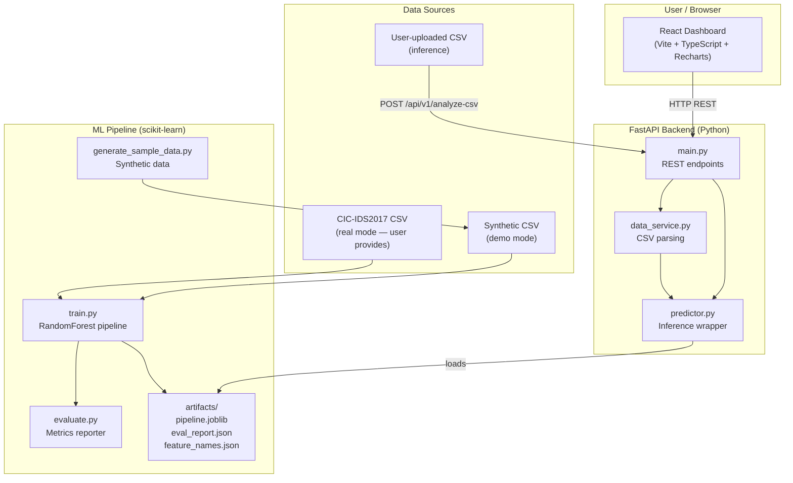

# Architecture: CyberSentinel

## System Architecture



## Data Flow

### Training Pipeline

```
generate_sample_data.py
        │ (synthetic CSV, seed=42)
        ▼
    train.py
        │ stratified train/test split (80/20)
        │ StandardScaler (fit on train only)
        │ RandomForestClassifier (class_weight=balanced)
        ▼
   ml/artifacts/
        ├── pipeline.joblib       (fitted sklearn Pipeline)
        ├── feature_names.json    (30 canonical feature names)
        ├── eval_report.json      (test-set metrics)
        └── mode.json             (demo | real)
```

### Inference Pipeline

```
User uploads CSV
        │
        ▼
data_service.parse_and_predict_csv()
        │ validate file type and size
        │ strip column whitespace
        │ check required features present
        │ coerce to float, reject inf/NaN rows
        ▼
predictor.predict_batch()
        │ reorder features to training schema
        │ forward to fitted pipeline
        ▼
RandomForest.predict() + predict_proba()
        │
        ▼
CsvAnalysisResponse (aggregate + row-level predictions)
        │
        ▼
React dashboard (paginated table, pie chart, metric bars)
```

## Component Responsibilities

| Module | Responsibility |
|--------|---------------|
| `ml/generate_sample_data.py` | Deterministic synthetic dataset (3 attack archetypes) |
| `ml/train.py` | Preprocessing + RF training + artifact serialization |
| `ml/evaluate.py` | Stand-alone evaluation on any compatible CSV |
| `backend/app/predictor.py` | Singleton model loader; batch prediction; feature importance |
| `backend/app/schemas.py` | Pydantic v2 request/response validation |
| `backend/app/data_service.py` | CSV parsing; row-level inference orchestration |
| `backend/app/main.py` | FastAPI app; CORS; endpoint routing |
| `frontend/src/services/api.ts` | Typed API client with XHR upload progress |
| `frontend/src/components/` | Header, SummaryCards, Visualizations, CsvUpload, ResultsTable, ModelInfo |

## Security Notes

- Uploaded CSV bytes are NOT executed; only parsed by pandas.
- Filenames are NOT used as filesystem paths (content is read from bytes).
- CSV size is capped at 50 MB / 10 000 rows.
- CORS origins are configurable via environment variable; not set to `*`.
- No authentication, database, or persistent storage is used.
- No secrets or dataset files are committed to the repository.
